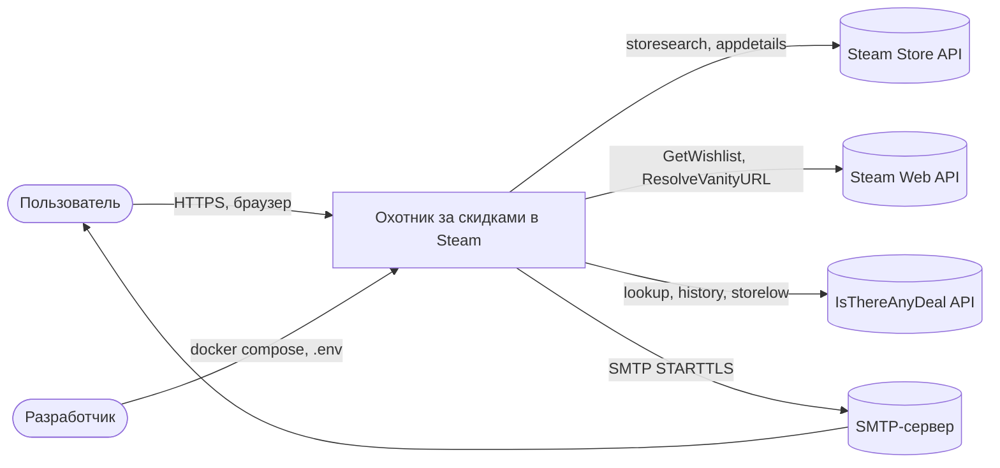
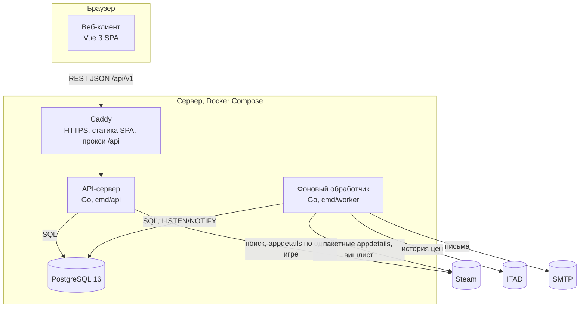
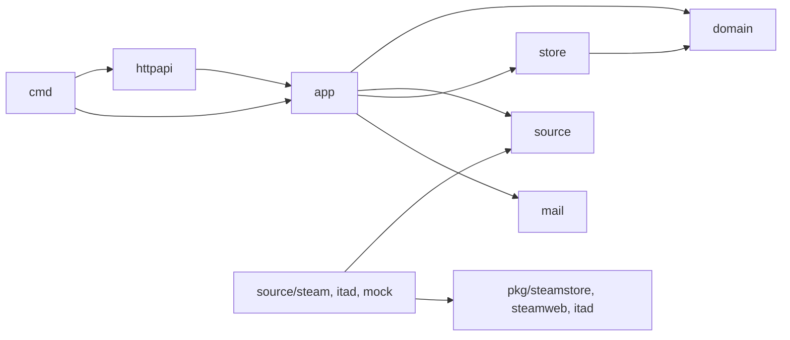
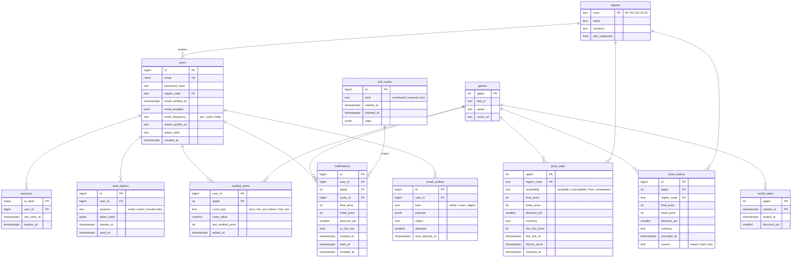
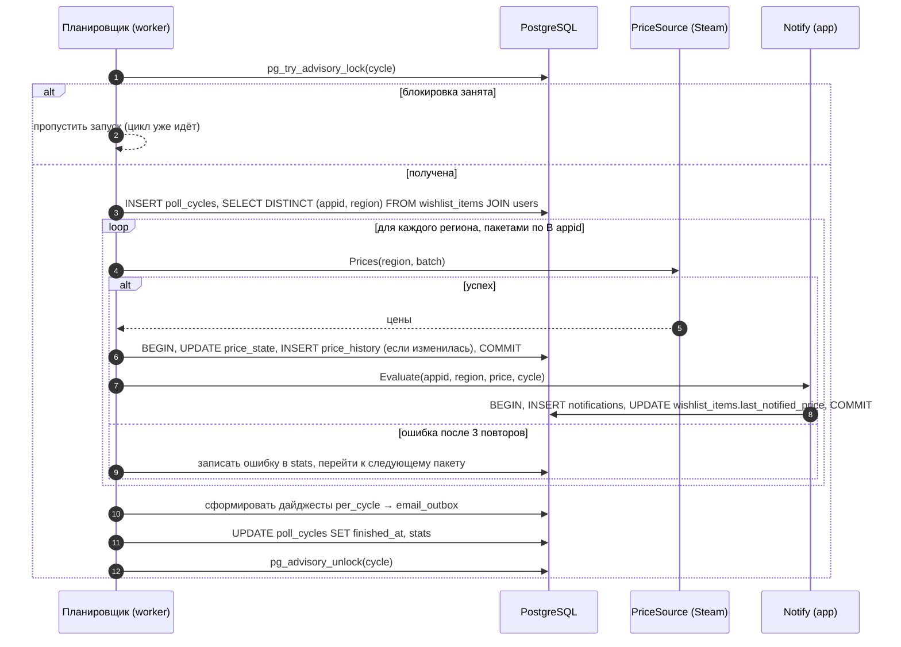
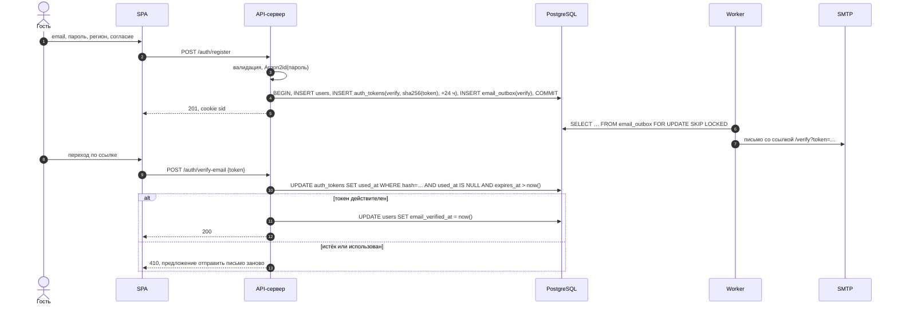
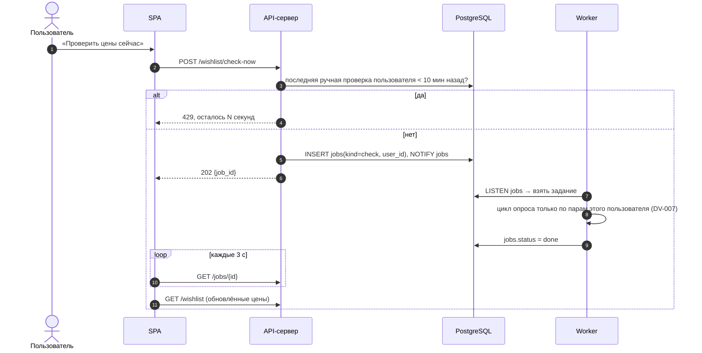
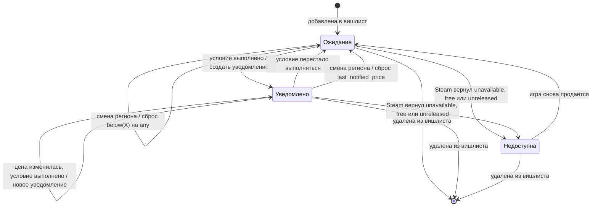
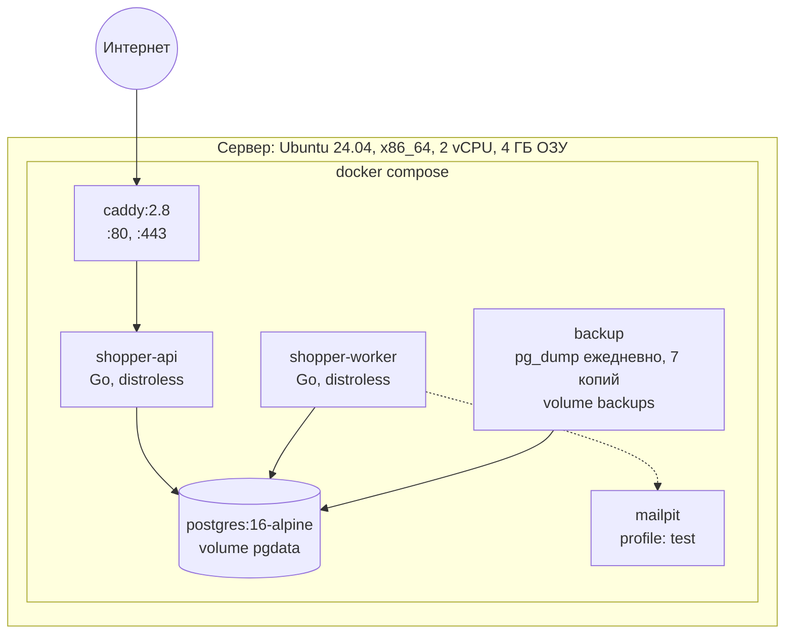

# Описание дизайна программного обеспечения

Для веб-сервиса «Охотник за скидками в Steam»

Версия 0.1

Подготовил Бутор К. П., гр. 450503

БГУИР, кафедра ЭВМ

24.10.2026

## Оглавление

<!-- TOC -->
* [1. Введение](#1-introduction)
  * [1.1 Назначение документа](#11-document-purpose)
  * [1.2 Область применения](#12-subject-scope)
  * [1.3 Определения, акронимы и сокращения](#13-definitions-acronyms-and-abbreviations)
  * [1.4 Ссылки](#14-references)
  * [1.5 Обзор документа](#15-document-overview)
* [2. Обзор дизайна](#2-design-overview)
  * [2.1 Задачи стейкхолдеров](#21-stakeholder-concerns)
  * [2.2 Выбранные точки зрения](#22-selected-viewpoints)
* [3. Проектные представления](#3-design-views)
  * [DV-001 Контекст системы](#dv-001)
  * [DV-002 Компоненты и их ответственность](#dv-002)
  * [DV-003 Структура кода и пакетов](#dv-003)
  * [DV-004 Модель данных](#dv-004)
  * [DV-005 REST API](#dv-005)
  * [DV-006 Интерфейсы источников данных](#dv-006)
  * [DV-007 Цикл опроса цен](#dv-007)
  * [DV-008 Регистрация и подтверждение email](#dv-008)
  * [DV-009 Ручная проверка цен](#dv-009)
  * [DV-010 Проверка условий и защита от повторов](#dv-010)
  * [DV-011 Состояния элемента вишлиста](#dv-011)
  * [DV-012 Параллелизм и ограничение запросов](#dv-012)
  * [DV-013 Отправка писем](#dv-013)
  * [DV-014 Развёртывание](#dv-014)
  * [DV-015 Бюджет ресурсов](#dv-015)
* [4. Решения](#4-decisions)
* [5. Приложения](#5-appendixes)
  * [Приложение А. Трассировка SRS → SDD](#5a-traceability)
  * [Приложение Б. Связь с планом реализации](#5b-plan)
<!-- TOC -->

## История изменений

| Name | Date | Reason For Changes | Version |
|------|------|--------------------|---------|
| Бутор К. П. | 24.10.2026 | Первоначальная версия на основе SRS v0.2 | 0.1 |

---

## 1. Введение {#1-introduction}

Документ описывает, **как** будет построен веб-сервис «Охотник за скидками в Steam» версии R1 (MVP). Требования к системе (что она делает) зафиксированы в SRS v0.2 и здесь не повторяются: каждое проектное представление ссылается на них по идентификаторам `REQ-…`.

### 1.1 Назначение документа {#11-document-purpose}

SDD служит руководством для реализации R1. Он задаёт разбиение системы на компоненты, модель данных, программные интерфейсы, ключевые алгоритмы и схему развёртывания, а также показывает, какой элемент дизайна реализует какое требование SRS.

Аудитории документа:

- **разработчики** (Бутор К. П. и junior-разработчик при его подключении) — реализация по разделу 3;
- **Заказчик** (Воронцов И. С.) и **преподаватель** — проверка того, что дизайн покрывает все требования R1 (Приложение А);
- **сопровождение** — развёртывание, резервное копирование, диагностика (DV-014, DV-015).

Значимые решения вынесены в отдельные записи ADR в каталоге `adr/`, раздел 4 содержит их перечень.

### 1.2 Область применения {#12-subject-scope}

Проектируемая система — веб-сервис «Охотник за скидками в Steam», релиз R1. Сервис отслеживает цены игр из вишлиста пользователя в выбранном регионе Steam (BY, RU, KZ, US, PL), хранит историю цен, вычисляет исторический минимум и уведомляет пользователя по email и на сайте, когда выполняется заданное им условие.

Дизайн охватывает всю систему R1: веб-клиент, API-сервер, фоновый обработчик, базу данных и их развёртывание. Функции, отложенные в SRS до R2 (вход через Steam, Telegram, составные условия, английский интерфейс, премиум), в дизайн не входят. Для них предусмотрены только точки расширения (DV-006, DV-013).

### 1.3 Определения, акронимы и сокращения {#13-definitions-acronyms-and-abbreviations}

Термины предметной области (appid, регион, вишлист, исторический минимум, цикл опроса и т. д.) определены в SRS, раздел 1.3.

| Term | Definition |
|------|------------|
| ADR | Architecture Decision Record — запись значимого архитектурного решения |
| Advisory lock | Рекомендательная блокировка PostgreSQL, используемая для взаимного исключения процессов |
| DV | Design View — проектное представление (раздел 3) |
| ER | Entity-Relationship — модель «сущность-связь» |
| Outbox | Таблица исходящих писем, из которой фоновый обработчик отправляет письма с повторами |
| SDD | Software Design Description — описание дизайна программного обеспечения |
| SPA | Single Page Application — одностраничное веб-приложение |
| Token bucket | Алгоритм ограничения частоты: запрос выполняется, только если в «ведре» есть жетон, жетоны пополняются с постоянной скоростью |
| Модульный монолит | Одна кодовая база, разделённая на модули с явными границами и собираемая в несколько исполняемых файлов |

### 1.4 Ссылки {#14-references}

| Документ | Владелец | Версия / дата | Расположение | Статус |
|----------|----------|---------------|--------------|--------|
| SRS «Охотник за скидками в Steam» | Бутор К. П. | 0.2, 10.10.2026 | `srs/srs.md` | Нормативная |
| IEEE 1016-2009 Software Design Descriptions | IEEE | 2009 | https://standards.ieee.org/ieee/1016/4502/ | Нормативная |
| ISO/IEC/IEEE 42010:2011 Architecture description | ISO/IEC/IEEE | 2011 | https://www.iso.org/standard/50508.html | Справочная |
| Шаблоны SDD и ADR | Кафедра ЭВМ БГУИР | 2026 | `sdd/sdd-template.md`, `adr/adr-template.md` | Нормативная |
| Записи архитектурных решений | Бутор К. П. | 24.10.2026 | `adr/0001-…` – `adr/0008-…` | Нормативная |
| План реализации R1 | Бутор К. П. | 24.10.2026 | `plan/release-plan.md` | Справочная |
| Лабораторная работа №4 «Разработка и документирование системных требований» | Кафедра ЭВМ БГУИР | 2026 | Методические указания | Нормативная |

### 1.5 Обзор документа {#15-document-overview}

Раздел 2 перечисляет стейкхолдеров и выбранные точки зрения. Раздел 3 содержит проектные представления `DV-NNN`: каждое указывает точку зрения, описание (текст и диаграммы Mermaid) и реализуемые требования SRS. Раздел 4 ссылается на записи ADR. Приложение А содержит матрицу трассировки SRS → SDD. Изменения вносятся через pull request и фиксируются в таблице «История изменений».

---

## 2. Обзор дизайна {#2-design-overview}

Система строится как **модульный монолит на Go** из двух процессов (API-сервер и фоновый обработчик) с общей базой PostgreSQL и SPA на Vue.js. Все компоненты работают в контейнерах Docker на одном сервере. Внешние источники данных (Steam, IsThereAnyDeal, тестовый источник) подключаются через интерфейсы, поэтому бизнес-логика от них не зависит.

### 2.1 Задачи стейкхолдеров {#21-stakeholder-concerns}

| Стейкхолдер | Задачи | Где адресуются |
|-------------|--------|----------------|
| Пользователь | Своевременность уведомлений, корректность цен и истории, сохранность личных данных | DV-007, DV-010, DV-004, DV-008 |
| Заказчик | Покрытие требований R1, срок и стоимость, возможность развития в R2 | Приложение А, DV-006, `plan/release-plan.md` |
| Разработчики | Понятное разбиение на модули, тестируемость, независимость от внешних API | DV-002, DV-003, DV-006 |
| Сопровождение | Развёртывание одной командой, диагностика, резервное копирование | DV-014, DV-015 |
| Valve, IsThereAnyDeal | Соблюдение лимитов запросов и условий использования | DV-012, DV-006 |

### 2.2 Выбранные точки зрения {#22-selected-viewpoints}

Из 15 точек зрения IEEE 1016 выбраны 11, которые отвечают задачам из 2.1. Точки зрения Physical и Patterns не выделены отдельно: сервер один (описан в DV-014), а применённые паттерны указаны в DV-002 и DV-003. Structure объединена с Composition.

| Точка зрения | Представления | Язык |
|--------------|---------------|------|
| Context | DV-001 | Контекстная диаграмма (Mermaid flowchart) |
| Composition | DV-002 | Диаграмма компонентов (Mermaid flowchart) |
| Logical / Dependency | DV-003 | Дерево пакетов, граф зависимостей |
| Information | DV-004 | ER-диаграмма (Mermaid erDiagram) |
| Interface | DV-005, DV-006 | Таблица эндпоинтов, сигнатуры интерфейсов Go |
| Interaction | DV-007, DV-008, DV-009 | Диаграммы последовательности (Mermaid sequenceDiagram) |
| Algorithm | DV-010 | Псевдокод, таблица решений |
| State Dynamics | DV-011 | Диаграмма состояний (Mermaid stateDiagram) |
| Concurrency | DV-012, DV-013 | Текст, псевдокод |
| Deployment | DV-014 | Диаграмма развёртывания (Mermaid flowchart) |
| Resources | DV-015 | Расчётные таблицы |

---

## 3. Проектные представления {#3-design-views}

### DV-001 Контекст системы {#dv-001}

- **ID:** DV-001-context
- **Title:** Контекст системы
- **Viewpoint:** Context
- **Representation:**



Система только читает данные внешних сервисов и ничего в них не изменяет. Steam — обязательная зависимость: без него не обновляются цены, но сайт продолжает работать с последними известными данными. IsThereAnyDeal и SMTP — необязательные: при их недоступности пропадают только подгрузка истории и письма соответственно.

- **More Information:** REQ-INT-006, REQ-INT-008, REQ-INT-009, REQ-INT-010, REQ-REL-003, REQ-REL-004. Контекстная диаграмма SRS — `srs/images/context.png`.

### DV-002 Компоненты и их ответственность {#dv-002}

- **ID:** DV-002-components
- **Title:** Компоненты и их ответственность
- **Viewpoint:** Composition
- **Representation:**



| Компонент | Ответственность | Не делает |
|-----------|-----------------|-----------|
| Веб-клиент (SPA) | Экраны из SRS 3.1.1, валидация форм, график цены, опрос статуса ручной проверки | Не обращается к внешним API напрямую |
| Caddy | TLS-сертификат, редирект HTTP → HTTPS, раздача собранного SPA, проксирование `/api` и `/healthz` | Не содержит бизнес-логики |
| API-сервер | Учётные записи и сессии, вишлист, условия, выдача цен и истории, центр уведомлений, постановка заданий для обработчика | Не опрашивает цены по расписанию и не отправляет письма |
| Фоновый обработчик | Цикл опроса цен, ручные проверки, импорт вишлиста, загрузка истории ITAD, проверка условий, формирование и отправка писем | Не принимает HTTP-запросы пользователей |
| PostgreSQL | Хранение всех данных, очередь заданий, взаимное исключение циклов (advisory lock) | — |

Связь между API-сервером и обработчиком идёт только через базу: API записывает задание в таблицу `jobs` и посылает `NOTIFY jobs`, обработчик забирает задание. Поэтому процессы можно перезапускать независимо друг от друга, а задание не теряется (ADR-0001).

- **More Information:** SRS 2.6, REQ-DIST-001, REQ-AVAIL-002, REQ-SEC-002. Решения: ADR-0001, ADR-0008.

### DV-003 Структура кода и пакетов {#dv-003}

- **ID:** DV-003-packages
- **Title:** Структура кода и пакетов
- **Viewpoint:** Logical, Dependency
- **Representation:**

```text
.
├── cmd/
│   ├── api/                 # точка входа API-сервера
│   └── worker/              # точка входа фонового обработчика
├── internal/
│   ├── domain/              # сущности и чистая логика: Condition, Price, HistoricalLow
│   ├── app/                 # сценарии: auth, wishlist, pricing, notify, digest, importer
│   ├── source/              # интерфейсы PriceSource, GameSearch, WishlistSource, HistorySource
│   │   ├── steam/           # адаптер к pkg/steamstore и pkg/steamweb
│   │   ├── itad/            # адаптер к pkg/itad
│   │   └── mock/            # тестовый источник (REQ-FUNC-030)
│   ├── store/postgres/      # репозитории, транзакции, очередь jobs
│   ├── mail/                # SMTP-отправитель и шаблоны писем
│   ├── httpapi/             # обработчики REST, middleware: сессия, CSRF, лимиты
│   └── platform/            # конфигурация, журналы slog, rate limiter, часы
├── pkg/
│   ├── steamstore/          # клиент Steam Store API (переиспользуемый)
│   ├── steamweb/            # клиент Steam Web API (переиспользуемый)
│   └── itad/                # клиент IsThereAnyDeal API (переиспользуемый)
├── migrations/              # версионированные SQL-миграции goose
├── web/                     # Vue 3 + Vite + Pinia + Vue Router + Chart.js
├── locales/ru.json          # тексты интерфейса и писем
├── deploy/                  # Caddyfile, скрипт резервного копирования
├── docker-compose.yml
└── .env.example
```

Правила зависимостей (проверяются линтером `depguard` в CI):



- `internal/domain` не импортирует ничего, кроме стандартной библиотеки. В нём живут правила, которые покрываются модульными тестами на 70 % и выше: проверка условий, исторический минимум, защита от повторов.
- `internal/app` зависит только от интерфейсов `source` и `store`, а не от конкретных реализаций. Реализация выбирается в `cmd/*` по конфигурации (паттерн «порты и адаптеры»).
- Пакеты `pkg/*` не импортируют `internal/*` и могут быть вынесены в отдельный модуль.

- **More Information:** REQ-MAINT-001, REQ-MAINT-002, REQ-MAINT-003, REQ-REUSE-001, REQ-INT-001, REQ-BUILD-001. Решение: ADR-0001.

### DV-004 Модель данных {#dv-004}

- **ID:** DV-004-data-model
- **Title:** Модель данных
- **Viewpoint:** Information
- **Representation:**



Ключевые решения по данным:

- Цены хранятся в **минимальных единицах валюты** (`int`), как их возвращает Steam: 3999 = $39.99. Конвертации валют нет (REQ-FUNC-005).
- `price_state` хранит одну строку на пару (игра, регион) с текущей ценой, временем последней проверки и кэшем исторического минимума. `price_history` пополняется **только при изменении** цены или скидки (ADR-0004).
- Уникальный индекс `price_history (appid, region_code, recorded_at, source)` и уникальный индекс `notifications (user_id, appid, cycle_id)` не дают создать дубликаты при перезапуске цикла (REQ-REL-006).
- Персональные данные есть только в `users`, `sessions`, `auth_tokens`, `wishlist_items`, `notifications`, `email_outbox`; у всех внешних ключей на `users` стоит `ON DELETE CASCADE` (REQ-FUNC-007, REQ-SEC-010). Таблицы цен общие и не удаляются вместе с пользователем.
- Токены и идентификаторы сессий хранятся только в виде хэша SHA-256 (REQ-SEC-006).
- Очистка по расписанию: уведомления старше 90 дней, просроченные токены и сессии удаляются ежесуточно (REQ-FUNC-028).
- Схема создаётся миграциями goose при запуске API-сервера (REQ-INST-003, ADR-0002).

- **More Information:** SRS Приложение Б, REQ-FUNC-018, REQ-FUNC-023, REQ-PERF-006. Решения: ADR-0002, ADR-0004.

### DV-005 REST API {#dv-005}

- **ID:** DV-005-rest-api
- **Title:** REST API между веб-клиентом и API-сервером
- **Viewpoint:** Interface
- **Representation:** JSON по HTTPS, префикс `/api/v1`, описание в `api/openapi.yaml` (OpenAPI 3.1). Аутентификация — cookie `sid` (`HttpOnly`, `Secure`, `SameSite=Lax`). Изменяющие запросы требуют заголовок `X-CSRF-Token`, совпадающий с cookie `csrf` (double submit). Ошибки возвращаются в едином формате `{"error": {"code": "...", "message": "...", "field": "..."}}`.

| Метод и путь | Назначение | Требования |
|--------------|------------|------------|
| `POST /auth/register` | Регистрация, письмо подтверждения | REQ-FUNC-001 |
| `POST /auth/verify-email` | Подтверждение по токену | REQ-FUNC-002 |
| `POST /auth/resend-verification` | Повторная отправка письма (раз в 60 с) | REQ-FUNC-002, REQ-SEC-005 |
| `POST /auth/login`, `POST /auth/logout` | Вход и выход | REQ-FUNC-003, REQ-SEC-005 |
| `POST /auth/password-reset`, `POST /auth/password-reset/confirm` | Сброс пароля | REQ-FUNC-004, REQ-SEC-007 |
| `GET /me`, `PATCH /me` | Профиль: регион, настройки писем, ссылка Steam | REQ-FUNC-005, REQ-FUNC-006 |
| `DELETE /me` | Удаление учётной записи с паролем | REQ-FUNC-007 |
| `GET /regions` | Список поддерживаемых регионов | REQ-FUNC-005 |
| `GET /games/search?q=` | Поиск в Steam (до 20 результатов) | REQ-FUNC-008 |
| `GET /wishlist?sort=&filter=` | Вишлист с ценами и минимумом | REQ-FUNC-012, REQ-FUNC-013 |
| `POST /wishlist` | Добавить по appid или ссылке | REQ-FUNC-009, REQ-FUNC-011 |
| `PATCH /wishlist/{appid}` | Изменить условие уведомления | REQ-FUNC-015 |
| `DELETE /wishlist/{appid}` | Удалить игру | REQ-FUNC-014 |
| `POST /wishlist/import` | Поставить задание импорта вишлиста Steam | REQ-FUNC-010 |
| `POST /wishlist/check-now` | Поставить ручную проверку (раз в 10 мин) | REQ-FUNC-020 |
| `GET /jobs/{id}` | Статус задания импорта или проверки | REQ-FUNC-010, REQ-FUNC-020 |
| `GET /games/{appid}` | Страница игры: цена, минимум, мировые скидки | REQ-FUNC-021, REQ-FUNC-023, REQ-FUNC-024 |
| `GET /games/{appid}/history?range=3m\|1y\|all` | Точки графика с источником | REQ-FUNC-022 |
| `GET /notifications`, `POST /notifications/read-all` | Центр уведомлений | REQ-FUNC-028 |
| `POST /unsubscribe` | Отписка по токену из письма, без сессии | REQ-FUNC-029 |
| `PUT /test/prices`, `POST /test/cycles` | Задать цену и запустить цикл; маршруты регистрируются только при `TEST_MODE=true`, иначе 404 | REQ-FUNC-030 |
| `GET /healthz` (без префикса) | 200/503, версия, время последнего цикла | REQ-OBS-003, REQ-BUILD-003 |

Обращение к чужим данным невозможно по построению: все запросы к вишлисту и уведомлениям фильтруются по `user_id` из сессии, а идентификатор чужой записи даёт 404 (REQ-SEC-004).

- **More Information:** REQ-INT-011, REQ-SEC-003, REQ-SEC-009. Решение: ADR-0005.

### DV-006 Интерфейсы источников данных {#dv-006}

- **ID:** DV-006-sources
- **Title:** Интерфейсы источников данных
- **Viewpoint:** Interface
- **Representation:**

```go
package source

type PriceSource interface {
    // Цены нескольких игр в одном регионе; пакетный appdetails?filters=price_overview.
    Prices(ctx context.Context, region string, appIDs []int) (map[int]domain.Price, error)
}

type GameSearch interface {
    Search(ctx context.Context, region, query string, limit int) ([]domain.GameHit, error)
    Details(ctx context.Context, region string, appID int) (domain.Game, domain.Price, error)
}

type WishlistSource interface {
    ResolveProfile(ctx context.Context, profileURL string) (steamID64 string, err error)
    Wishlist(ctx context.Context, steamID64 string) ([]domain.WishlistEntry, error)
}

type HistorySource interface {
    // Возвращает ErrRegionUnsupported для BY, RU, KZ.
    History(ctx context.Context, region string, appID int, since time.Time) ([]domain.HistoryPoint, error)
    WorldSales(ctx context.Context, appID int, since time.Time) ([]domain.Sale, error)
}
```

| Реализация | PriceSource | GameSearch | WishlistSource | HistorySource |
|------------|:-:|:-:|:-:|:-:|
| `source/steam` | ✔ | ✔ | ✔ | |
| `source/itad` | | | | ✔ |
| `source/mock` (тестовый режим) | ✔ | ✔ (по таблице `games`) | ✔ (фиксированный список) | ✔ (пусто) |

`domain.Price` содержит признак доступности (`available`, `unavailable`, `free`, `unreleased`), поэтому особые состояния игры (REQ-FUNC-016) определяются в адаптере и не протекают в бизнес-логику. Все реализации оборачиваются общим декоратором повторов (3 попытки, 1/2/4 с, учёт `Retry-After`) и ограничителем частоты (DV-012).

Для R2 новые магазины добавляются новой реализацией тех же интерфейсов, а Telegram — новой реализацией интерфейса `mail.Notifier` (DV-013).

- **More Information:** REQ-MAINT-001, REQ-REUSE-001, REQ-INT-006…009, REQ-REL-001, REQ-FUNC-016, REQ-FUNC-030. Решение: ADR-0003.

### DV-007 Цикл опроса цен {#dv-007}

- **ID:** DV-007-poll-cycle
- **Title:** Цикл опроса цен
- **Viewpoint:** Interaction
- **Representation:**



- Цикл запускается по таймеру с периодом `POLL_INTERVAL` (по умолчанию 3 ч, от 1 до 24 ч), а также заданием ручной проверки или тестового цикла.
- Каждая пара запрашивается один раз за цикл, сколько бы пользователей её ни отслеживали (REQ-FUNC-017). Пары группируются по региону, потому что пакетный запрос `appdetails` принимает один `cc`.
- Ошибка одного пакета не прерывает цикл, пара будет запрошена в следующем цикле (REQ-REL-002).
- Обработка каждой пары — отдельная транзакция. После аварийного перезапуска повторная обработка той же цены ничего не меняет: цена в `price_state` уже совпадает, а уведомление защищено `last_notified_price` и уникальным индексом (REQ-REL-006).
- По окончании цикла в журнал пишется статистика (REQ-OBS-002).

- **More Information:** REQ-FUNC-017, REQ-FUNC-018, REQ-FUNC-025, REQ-FUNC-027, REQ-PERF-004, REQ-PERF-005, REQ-REL-002, REQ-REL-006, REQ-DIST-001. Решения: ADR-0004, ADR-0006.

### DV-008 Регистрация и подтверждение email {#dv-008}

- **ID:** DV-008-registration
- **Title:** Регистрация и подтверждение email
- **Viewpoint:** Interaction
- **Representation:**



Письмо не отправляется из обработчика HTTP-запроса: API только кладёт его в `email_outbox` в той же транзакции, что и пользователя. Регистрация не зависит от доступности SMTP, а письмо не теряется (DV-013).

- **More Information:** REQ-FUNC-001, REQ-FUNC-002, REQ-SEC-001, REQ-SEC-006, REQ-COMP-001. Решения: ADR-0005, ADR-0007.

### DV-009 Ручная проверка цен {#dv-009}

- **ID:** DV-009-check-now
- **Title:** Ручная проверка цен
- **Viewpoint:** Interaction
- **Representation:**



Ручная проверка использует тот же код, что и плановый цикл, и ту же блокировку. Если плановый цикл уже идёт, задание ждёт его окончания, и пользователь получает свежие цены из него.

- **More Information:** REQ-FUNC-020, REQ-INT-007. Решение: ADR-0006.

### DV-010 Проверка условий и защита от повторов {#dv-010}

- **ID:** DV-010-conditions
- **Title:** Проверка условий и защита от повторов
- **Viewpoint:** Algorithm
- **Representation:** алгоритм реализуется в `internal/domain` чистыми функциями без ввода-вывода.

Таблица решений «условие выполнено» (`p` — итоговая цена, `d` — скидка в процентах, `L` — исторический минимум до учёта текущей цены):

| Условие | Выполнено, если |
|---------|-----------------|
| any | `d > 0` |
| min_pct(N) | `d ≥ N` |
| below(X) | `p ≤ X` (X в минимальных единицах валюты региона) |
| hist_low | `d > 0` и (`L` не определён или `p ≤ L`) |

Для игр в состоянии `unavailable`, `free` или `unreleased` условие не проверяется (REQ-FUNC-016).

```text
function Evaluate(item, price, histLow, cycle):
    if price.availability != available:
        return nothing
    met := Condition(item.cond).Met(price, histLow)
    if not met:
        item.last_notified_price := NULL            // скидка закончилась: следующая снова уведомит
        return nothing
    if item.last_notified_price == price.final:
        return nothing                              // уже уведомляли об этой цене
    item.last_notified_price := price.final
    return Notification{user, appid, price, is_hist_low: price.final <= histLow, cycle}
```

Исторический минимум хранится в `price_state.hist_low_price` и пересчитывается при каждой вставке в `price_history`: `min(старый минимум, новая цена)`. Для регионов US и PL в расчёт входят записи ITAD, для BY, RU, KZ только собственные записи. Поле `history_since` хранит дату самой ранней записи. Если до неё меньше 90 дней, клиент показывает пометку «История неполная» (REQ-FUNC-023).

Сложность обработки одной пары — O(k), где k — число пользователей, отслеживающих пару в регионе. Все k элементов читаются одним запросом по индексу `wishlist_items (appid)`.

- **More Information:** REQ-FUNC-015, REQ-FUNC-016, REQ-FUNC-023, REQ-FUNC-025, REQ-FUNC-026, REQ-MAINT-003.

### DV-011 Состояния элемента вишлиста {#dv-011}

- **ID:** DV-011-item-states
- **Title:** Состояния элемента вишлиста относительно уведомлений
- **Viewpoint:** State Dynamics
- **Representation:**



Состояние не хранится отдельным полем: «Уведомлено» означает `last_notified_price IS NOT NULL`, «Недоступна» берётся из `price_state.availability`. Смена региона пользователя выполняется в одной транзакции: обновляется `users.region_code`, условия `below` заменяются на `any`, `last_notified_price` обнуляется (REQ-FUNC-005).

- **More Information:** REQ-FUNC-005, REQ-FUNC-014, REQ-FUNC-016, REQ-FUNC-026.

### DV-012 Параллелизм и ограничение запросов {#dv-012}

- **ID:** DV-012-concurrency
- **Title:** Параллелизм и ограничение запросов
- **Viewpoint:** Concurrency
- **Representation:**

1. **Один цикл одновременно.** Каждый цикл (плановый, ручной, тестовый) выполняется под `pg_advisory_lock(42)`. Плановый запуск при занятой блокировке пропускается, а задания (ручная проверка, тестовый цикл, второй экземпляр обработчика) ждут её освобождения. Поэтому два цикла никогда не идут параллельно (REQ-DIST-001).
2. **Общий бюджет запросов к Steam.** Лимит из REQ-INT-007 — 150 запросов за любые 5 минут с одного IP. Обращаются к Steam оба процесса, поэтому бюджет делится статически:

   | Процесс | Назначение | Бюджет за 5 мин | Реализация |
   |---------|------------|-----------------|------------|
   | Worker | циклы опроса, импорт вишлиста | 120 | скользящее окно, 1 запрос в 2,5 с |
   | API | поиск, добавление по appid | 30 | скользящее окно; при исчерпании 503 «Steam временно недоступен» |

   Сумма 150 не превышает лимит при любом сочетании нагрузки.
3. **Пауза после 429/403.** Ограничитель переводится в состояние «пауза» минимум на 60 с (или на `Retry-After`). Пауза общая для всех горутин процесса.
4. **Внутри цикла** пакеты обрабатываются последовательно одной горутиной: узкое место — лимит Steam, а не CPU, и параллельность не ускорит цикл. Загрузка истории ITAD идёт в отдельной горутине со своим лимитом (ITAD — 1000 запросов за 5 минут).
5. **Очередь заданий** читается конструкцией `SELECT … FOR UPDATE SKIP LOCKED`, поэтому одно задание не возьмут два обработчика.
6. **Корректное завершение.** По SIGTERM обработчик дожидается окончания текущей транзакции пары (не дольше 30 с) и снимает блокировку. Незавершённый цикл продолжится со следующего запуска.

- **More Information:** REQ-INT-007, REQ-DIST-001, REQ-REL-001, REQ-REL-006, REQ-AVAIL-002. Решение: ADR-0006.

### DV-013 Отправка писем {#dv-013}

- **ID:** DV-013-mail
- **Title:** Отправка писем
- **Viewpoint:** Concurrency, Interaction
- **Representation:**

- Все письма (подтверждение, сброс, дайджест) создаются записью в `email_outbox` в той же транзакции, что и вызвавшее их событие.
- Горутина отправки в обработчике раз в 10 с выбирает до 50 писем со статусом `pending` и `next_attempt_at ≤ now()`. При ошибке SMTP увеличивает `attempts` и переносит отправку на 5 минут. После трёх неудач письмо получает статус `failed` и попадает в журнал (REQ-REL-005).
- **Дайджест «после каждой проверки»** формируется в конце цикла: одно письмо на пользователя со всеми его уведомлениями цикла.
- **Дайджест «раз в сутки»** формируется планировщиком в 10:00 `Europe/Minsk`: одно письмо со всеми уведомлениями за 24 часа, у которых `emailed_at IS NULL`.
- Письма получают только пользователи с `email_verified_at IS NOT NULL` и `email_enabled = true`. Уведомления на сайте создаются в любом случае.
- В каждом дайджесте есть ссылка отписки с одноразовым токеном `unsubscribe` (REQ-FUNC-029).
- Отправка скрыта за интерфейсом `Notifier`. В R1 есть реализации `SMTPNotifier` и `MailpitNotifier` (тестовый режим), в R2 добавится `TelegramNotifier`.

- **More Information:** REQ-FUNC-002, REQ-FUNC-006, REQ-FUNC-027, REQ-FUNC-029, REQ-INT-010, REQ-REL-005. Решение: ADR-0007.

### DV-014 Развёртывание {#dv-014}

- **ID:** DV-014-deployment
- **Title:** Развёртывание
- **Viewpoint:** Deployment
- **Representation:**



| Контейнер | Образ | Перезапуск | Проверка здоровья |
|-----------|-------|------------|-------------------|
| caddy | `caddy:2.8` с собранным SPA | `unless-stopped` | — |
| api | multi-stage Go → `gcr.io/distroless/static` | `unless-stopped` | `GET /healthz` |
| worker | тот же образ, команда `worker` | `unless-stopped` | время последнего цикла в БД |
| db | `postgres:16-alpine` | `unless-stopped` | `pg_isready` |
| backup | `postgres:16-alpine` + cron | `unless-stopped` | — |
| mailpit | `axllent/mailpit` (только `--profile test`) | — | — |

- Развёртывание: `git clone`, `cp .env.example .env`, заполнить ключи, `docker compose up -d` (REQ-INST-001). Для демонстрации — `docker compose --profile test up -d` с `TEST_MODE=true`.
- Секреты (`ITAD_API_KEY`, `STEAM_WEB_API_KEY`, `SMTP_*`, `POSTGRES_PASSWORD`) передаются только через `.env`, который исключён из Git (REQ-SEC-008).
- Образы собираются с фиксированными версиями базовых образов; GitHub Actions на каждый pull request запускает `golangci-lint`, `go test`, `eslint`, `vitest` и сборку образов (REQ-BUILD-001, REQ-BUILD-002).
- Версия из Git-тега передаётся при сборке (`-ldflags -X main.version`) и отображается в `/healthz` и журналах (REQ-BUILD-003).

- **More Information:** REQ-INST-001…003, REQ-DIST-001, REQ-PORT-001, REQ-AVAIL-002, REQ-AVAIL-003, REQ-SEC-002, REQ-COST-001. Решение: ADR-0008.

### DV-015 Бюджет ресурсов {#dv-015}

- **ID:** DV-015-resources
- **Title:** Бюджет ресурсов
- **Viewpoint:** Resources
- **Representation:**

**Запросы к Steam за цикл** (эталон SRS: 2000 пар, бюджет обработчика 120 запросов за 5 мин = 24 в минуту):

| Размер пакета `appdetails` (B) | Запросов за цикл | Длительность цикла | REQ-PERF-004 (≤ 60 мин) |
|---|---|---|---|
| 1 | 2000 | 83 мин | не выполняется |
| 2 | 1000 | 42 мин | выполняется |
| 20 | 100 | 4,2 мин | выполняется |
| 50 | 40 | 1,7 мин | выполняется |

Требование выполняется уже при B ≥ 2. Фактический B определяется в первой итерации задачей REQ-POC-002. Если окажется B = 1, минимальный период опроса будет поднят до 2 часов через запрос на изменение SRS.

**Объём базы данных** (1000 пользователей, 2000 пар, 2 года):

| Таблица | Строк | Размер строки с индексами | Объём |
|---------|-------|---------------------------|-------|
| price_history (собственная, ~40 изменений на пару в год) | 160 000 | ~120 Б | ~19 МБ |
| price_history (ITAD для US/PL, ~150 точек на игру) | 120 000 | ~120 Б | ~14 МБ |
| wishlist_items (в среднем 50 игр на пользователя) | 50 000 | ~100 Б | ~5 МБ |
| notifications (90 дней) | ~100 000 | ~120 Б | ~12 МБ |
| Прочие таблицы | — | — | < 10 МБ |
| **Итого** | | | **~60 МБ ≪ 1 ГБ** |

**Память и CPU:** API-сервер и обработчик — по 50–100 МБ ОЗУ, PostgreSQL — до 512 МБ (`shared_buffers=128MB`). Нагрузка на CPU определяется сетевым ожиданием и не превышает долей ядра. Эталонного сервера с 2 vCPU и 4 ГБ достаточно с запасом.

**Соединения с БД:** пул pgx — 10 соединений у API и 4 у обработчика (один из них держит advisory lock и LISTEN).

- **More Information:** REQ-PERF-001, REQ-PERF-004, REQ-PERF-006, REQ-INT-007, REQ-POC-002, допущение A-9.

---

## 4. Решения {#4-decisions}

Значимые решения оформлены по шаблону MADR в отдельных файлах каталога `adr/`.

| ID | Решение | Статус | Затрагивает |
|----|---------|--------|-------------|
| [ADR-0001](../adr/0001-modular-monolith-api-and-worker.md) | Модульный монолит на Go из двух процессов: API и фоновый обработчик | accepted | DV-002, DV-003 |
| [ADR-0002](../adr/0002-postgresql-as-primary-db.md) | PostgreSQL как единственное хранилище, включая очередь заданий | accepted | DV-004, DV-012 |
| [ADR-0003](../adr/0003-steam-as-price-source-itad-for-history.md) | Steam — источник текущих цен, ITAD — только история для US и PL | accepted | DV-006, DV-010 |
| [ADR-0004](../adr/0004-store-price-history-on-change.md) | Хранить историю цен только при изменении, текущее состояние отдельно | accepted | DV-004, DV-007 |
| [ADR-0005](../adr/0005-server-sessions-in-cookie.md) | Серверные сессии в cookie вместо JWT | accepted | DV-005, DV-008 |
| [ADR-0006](../adr/0006-single-cycle-lock-and-rate-budget.md) | Один цикл через advisory lock и статический бюджет запросов к Steam | accepted | DV-007, DV-012 |
| [ADR-0007](../adr/0007-email-outbox-and-smtp-provider.md) | Отправка писем через outbox; Gmail SMTP в эксплуатации, Mailpit в тестовом режиме | accepted | DV-013 |
| [ADR-0008](../adr/0008-docker-compose-single-host.md) | Развёртывание Docker Compose на одном сервере за Caddy | accepted | DV-014 |

---

## 5. Приложения {#5-appendixes}

### Приложение А. Трассировка SRS → SDD {#5a-traceability}

| Требования SRS | Проектные представления |
|----------------|-------------------------|
| REQ-INT-001…005 (интерфейс пользователя) | DV-003 (`web/`, `locales/`) |
| REQ-INT-006…009 (Steam, ITAD) | DV-006, DV-012 |
| REQ-INT-010 (SMTP) | DV-013 |
| REQ-INT-011 (REST API) | DV-005 |
| REQ-FUNC-001…004 (учётная запись) | DV-005, DV-008 |
| REQ-FUNC-005 (регион) | DV-004, DV-011 |
| REQ-FUNC-006, REQ-FUNC-027, REQ-FUNC-029 (письма) | DV-013 |
| REQ-FUNC-007 (удаление) | DV-004 |
| REQ-FUNC-008…011 (поиск, добавление, импорт) | DV-005, DV-006 |
| REQ-FUNC-012…016 (вишлист, условия) | DV-005, DV-010, DV-011 |
| REQ-FUNC-017…019 (сбор цен, история) | DV-007, DV-004, DV-006 |
| REQ-FUNC-020 (ручная проверка) | DV-009 |
| REQ-FUNC-021…024 (страница игры) | DV-005, DV-010 |
| REQ-FUNC-025, REQ-FUNC-026 (проверка условий) | DV-010 |
| REQ-FUNC-028 (центр уведомлений) | DV-005, DV-004 |
| REQ-FUNC-030 (тестовый режим) | DV-006, DV-014 |
| REQ-PERF-001…006 | DV-015 |
| REQ-SEC-001…010 | DV-004, DV-005, DV-008, DV-014 |
| REQ-REL-001…006 | DV-006, DV-007, DV-013 |
| REQ-AVAIL-001…003 | DV-014 |
| REQ-OBS-001…004 | DV-007, DV-005 (`/healthz`), DV-003 (`platform`) |
| REQ-COMP-001…004 | DV-004, DV-006, DV-014 (CI-проверка лицензий) |
| REQ-INST, REQ-BUILD, REQ-DIST, REQ-PORT | DV-014 |
| REQ-MAINT-001…004, REQ-REUSE-001 | DV-003, DV-006 |
| REQ-POC-002 | DV-015 |

Открытый вопрос 2 SRS (почтовый провайдер) закрыт решением ADR-0007. Открытый вопрос 4 (размер пакета `appdetails`) остаётся открытым и закрывается в первой итерации плана.

### Приложение Б. Связь с планом реализации {#5b-plan}

Перечень функций, их приоритеты, оценки трудоёмкости и разбиение по итерациям ведутся в документе `plan/release-plan.md`. Каждая функция плана ссылается на требования SRS и проектные представления этого документа.
